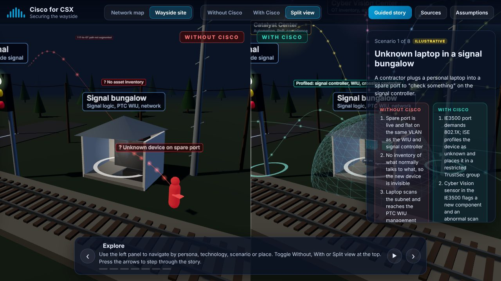
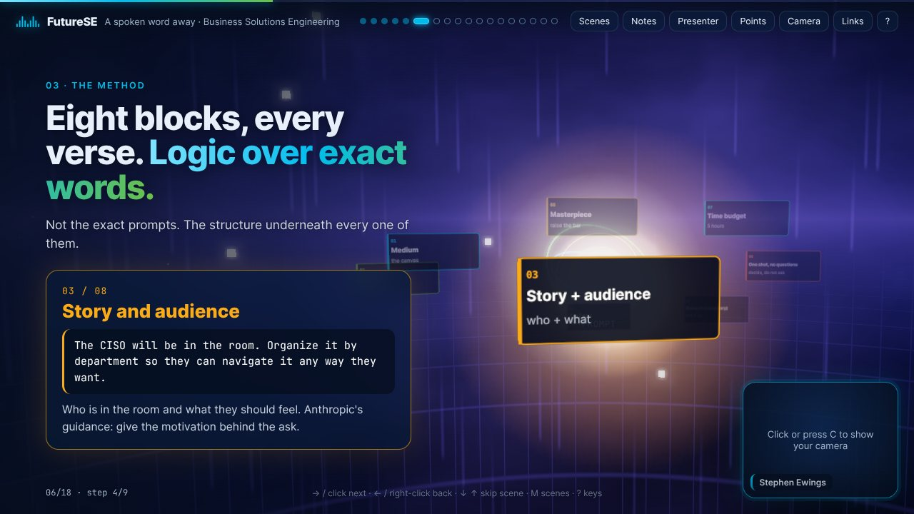
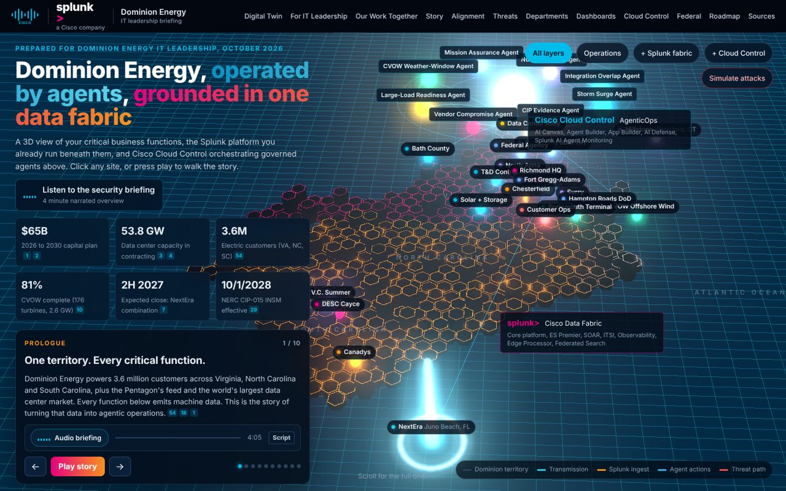
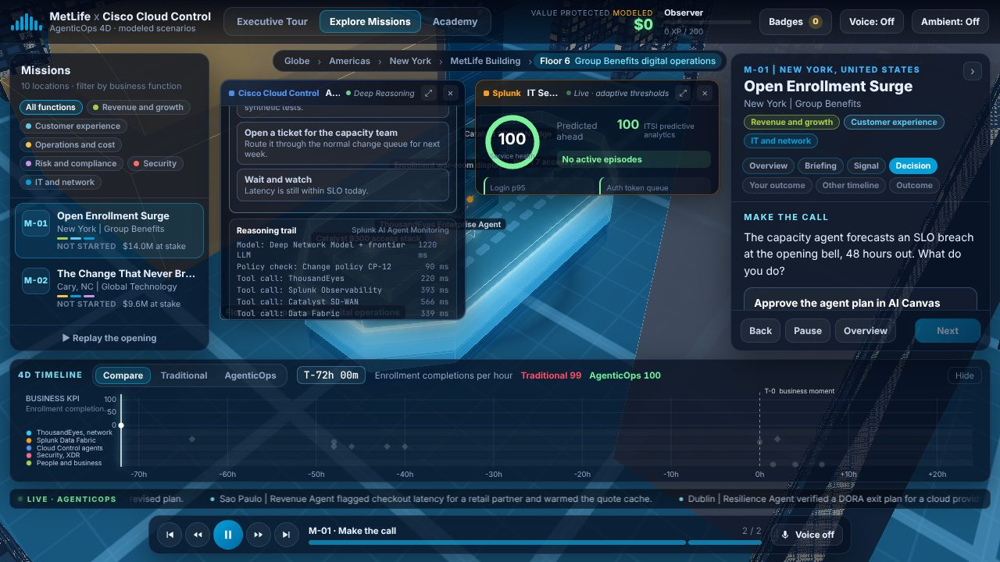
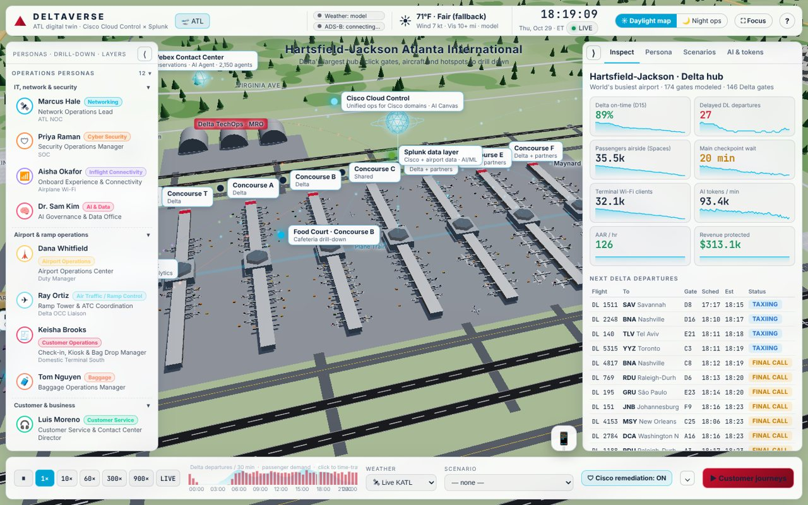
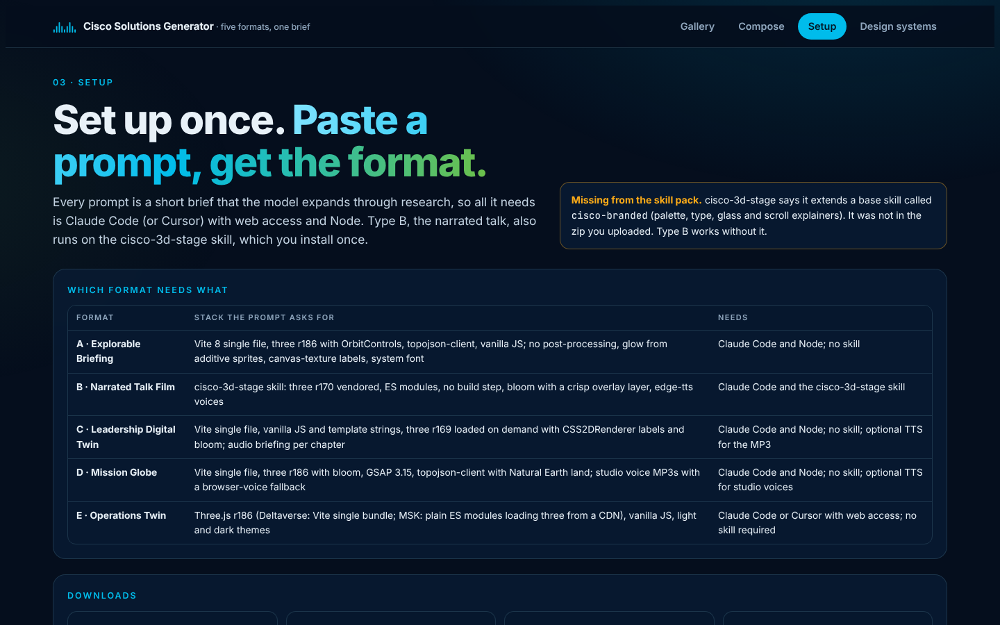
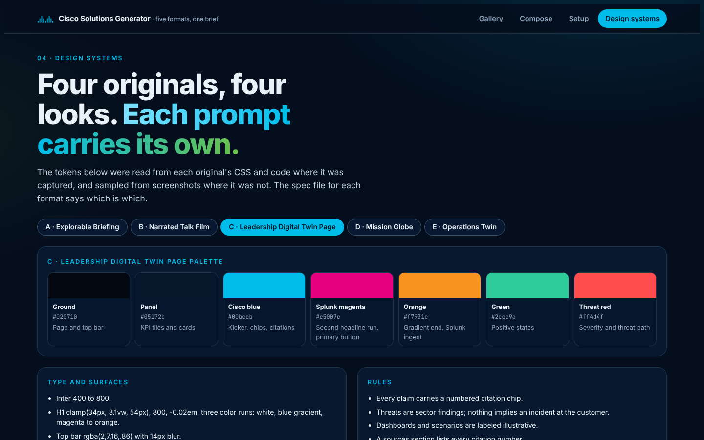

# Cisco Solutions Generator

**Turn a customer conversation into a customer-specific, interactive 3D story, from one prompt.**

The Cisco Solutions Generator is for Cisco sellers, solutions engineers and customer success managers who need visuals and storytelling that hold up in front of customer executives. You pick one of five proven presentation formats, describe the customer and the conversation (by typing or by talking), and copy one prompt into Claude Code or Cursor. The prompt is a short, intent-first brief, the same eight-block shape that produced every reference build: medium, customer, story and audience, key items, research, one shot, time and "create a masterpiece". It adds the format as an experience with live reference builds to clear, the ingredients every great build shares, a research-then-brief step and a proof-of-delivery list, and leaves the design to the model.

The formats come from eight published builds by Stephen Ewings (Solutions Engineer, Cisco). See [docs/examples](docs/examples/README.md) for why a short brief beats a long spec, with the same MedStar inputs run through the old and new generator.


**Get started:** read the [Instructions](docs/INSTRUCTIONS.md), or open [`generator/index.html`](generator/index.html) in Chrome or Edge.

---

## The five formats

Each format describes an experience and points the model at the live builds it came from. Only the talk (B) uses deck navigation, presenter windows and a camera box.

### A · Explorable Briefing



A single-screen 3D explorer for one customer and one executive audience. A top bar switches between the network map and a site diorama, and between Without Cisco, With Cisco and a Split view that renders both side by side. A left panel holds Personas, Technology, Scenarios and Places; a right panel shows details; a story dock runs a short guided story. Every item is badged PUBLIC, MODELED or ILLUSTRATIVE, and Sources and Assumptions open as panels.

*Studied from the CSX wayside briefing. Stack: three r186, OrbitControls, topojson-client, Vite single file. 34 elements.*

### B · Narrated Talk Film



A talk that moves like a slide deck through a row of lit 3D worlds: a new sky and particle formation on every scene, a glass HUD with two-clause headlines, presenter and talking-points windows, a camera box, a printable talk track, a live workshop, and a narrated film edition with an AI narrator.

*Studied from the FutureSE talk, "A spoken word away". Built on the `cisco-3d-stage` skill (three r170, no build step). 19 elements.*

### C · Leadership Digital Twin



A scrolling leave-behind page for a leadership team. The hero is a 3D hex twin of the customer's territory with layer chips (operations, data fabric, control plane, simulated attacks), six cited KPI tiles and a ten-chapter story card with an audio briefing. Below it, anchored sections cover outcomes, the work together, alignment, threats with counter boxes, departments, dashboards, capabilities, federal, roadmap and numbered sources.

*Studied from the Dominion Energy and Splunk briefing. Stack: three r169 with CSS2DRenderer and bloom, Vite single file. 34 elements.*

### D · Mission Globe



A game-like 3D globe with three modes. **Present** runs a narrated executive tour. **Play** lets people pick a mission, make the call at a decision point and get scored. **Learn** traces each IT signal to a business KPI, with discovery questions and a quiz. A mission rail with business-function filters, docking product windows, a 4D timeline comparing the traditional and agentic outcomes, a live ticker and a narration dock complete it. Every dollar figure is labeled modeled.

*Studied from MetLife AgenticOps 4D. Stack: three r186 with bloom, GSAP, topojson-client, Vite single file. 51 elements.*

### E · Operations Twin



A living 3D digital twin of the one site that runs the business: a hospital campus, an airport, a plant or a hub. A clock you can speed up, weather and people moving through it; a dozen or more timed story scenarios, each played with and without Cisco; lenses for each audience; an inspector with live KPIs; journeys; and a narrated guided tour. The closest precedent for a hospital system.

*Studied from the MSK Operations Twin (Memorial Sloan Kettering) and the Deltaverse (Hartsfield-Jackson Atlanta). Stack: Three.js r186. 16 elements.*

---

## What the generator does

### Write the brief


The fields follow the brief: account, where they are, what to discuss, who is in the room, navigate by, story device, must include, must not mention, integrations to call out, time budget and presenter, plus one or two per format. Fields start empty with examples as placeholders, and the prompt cannot be copied until the required ones are filled. Prompts run about 1,100 words.

### Ingredients, signature elements and the appendix


Nine ingredients every reference build shares are on by default, one line each: their real place as the stage, people as the way in, timed story scenarios, several lenses, before and after, a guided way in plus free exploration, a living world, an honesty layer, and depth. You can borrow signature elements from any format, and add the detailed technical appendix reverse engineered from a reference build when you want a close copy.

### Guardrails: build it, or guide me through it


Five guardrails are on by default: **one shot**, **no questions**, **time budget**, **make it real, then make it perfect**, and **create a masterpiece**. They open the prompt as operating rules that override everything else, so the model builds instead of asking for approval. "Create a masterpiece" is a broad approval for the model to decide what a masterpiece is; you can add your own examples or the gallery's quality bar if you want to steer it.

Uncheck **One shot** and the prompt becomes a staged, guided process: a skills check, questions or assumptions, a format-specific script for your approval, a first version with screenshots, then refinement passes, stopping for your go-ahead at each stage.


### Skills for the visuals


Every prompt tells the model to confirm the skills it relies on are installed and to use them for the visuals. One-shot builds note a missing skill and keep going; guided builds stop and help you install it.

### Talk it through


Every field has a dictation button, and **Talk it through** runs a spoken, step-by-step intake: it reads each question aloud, listens, fills the fields, takes voice commands, and can tidy your spoken answers on request.

### Setup and design systems

| Setup | Design systems |
|---|---|
|  |  |

**Setup** shows what each format needs, the skill install steps and the dependencies. **Design systems** shows each format's palette, type and rules.

---

## Repository layout

```
generator/              The generator. Open generator/index.html, or serve the folder (works on GitHub Pages).
  index.html            Standalone page: Gallery, Compose, Setup, Design systems
  src/                  Page source, per-format data (types.json, decks2.json) and the data builder
  decks/                The rebuilt example of each format, as single HTML files
  kits/                 Each format's prompt template and design and tech spec
  shots2/, shots/       Screenshots of the rebuilds and the originals
formats/                One kit per format (A-explorable-briefing, B-narrated-talk-film,
                        C-leadership-digital-twin, D-mission-globe)
  PROMPT.md             The prompt template, with {{PLACEHOLDERS}}
  PROMPT.filled.md      The template filled in for the original customer
  SPEC.md               The reverse-engineered design and tech spec
  prompt-fields.json    The form fields and sample values
  elements.json         Every element, with a prompt snippet (the composer's options)
  app/, dist/, shots/   The rebuild's source, its single-file build, and screenshots
skills/                 The SEVerse cisco-3d-stage skill pack
archive/                First-pass rebuilds on the cisco-3d-stage engine (superseded)
originals/captures/     Saved copies of the original builds used for the first reverse engineering
originals/sites/        All eight published builds as downloaded, with live screenshots
tools/                  Bundling, headless screenshot and page-conversion scripts, and generator tests
docs/                   Instructions, screenshots and the MedStar prompt comparison (docs/examples)
HISTORY.md              How the project was built, request by request
```

## Rebuilding the generator page

`generator/index.html` is assembled from `generator/src/generator-src.html` by replacing the `__TYPES_JSON__` and `__DECKS_JSON__` markers with `types.json` and `decks2.json`:

```bash
python3 tools/assemble_generator.py . /tmp/generator-page.html
```

The brief, the format descriptions and the ingredients live in the composer section of `generator-src.html`. `types.json` holds each format's elements and its technical appendix (from `formats/*/PROMPT.md`).

## Notes and limits

- **Dictation:** live in-page dictation works where the browser lets the page use the microphone (Chrome or Edge, from a file or a normal site). Inside the claude.ai artifact viewer the microphone is blocked, so the buttons point to system dictation.
- **Downloads:** the generator's download buttons use a claude.ai feature. On GitHub Pages or a local copy, take the files from this repository instead.
- **cisco-branded:** the base skill that `cisco-3d-stage` extends is not included.
- **Prompt testing:** the new brief-first prompts have not yet been run end to end; run the MedStar prompt in [docs/examples](docs/examples/medstar-new-prompt.md) and compare it with the earlier run.
- **Honesty:** figures in the examples are labeled public, modeled or illustrative as in the originals. Have a person review every generated build before it reaches a customer.
- Cisco names and marks belong to Cisco Systems, Inc. Third-party components in the skill pack are listed in [`skills/THIRD_PARTY_NOTICES.md`](skills/THIRD_PARTY_NOTICES.md).
