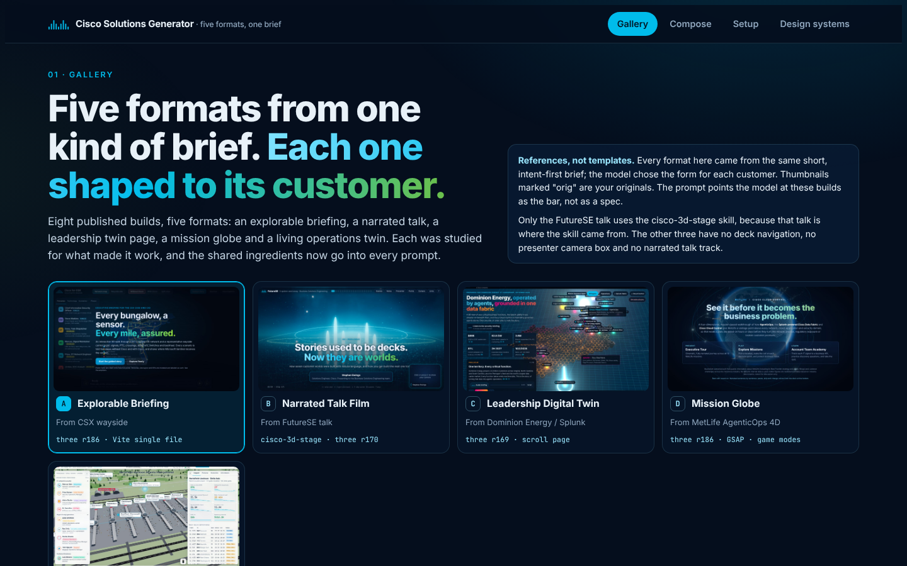
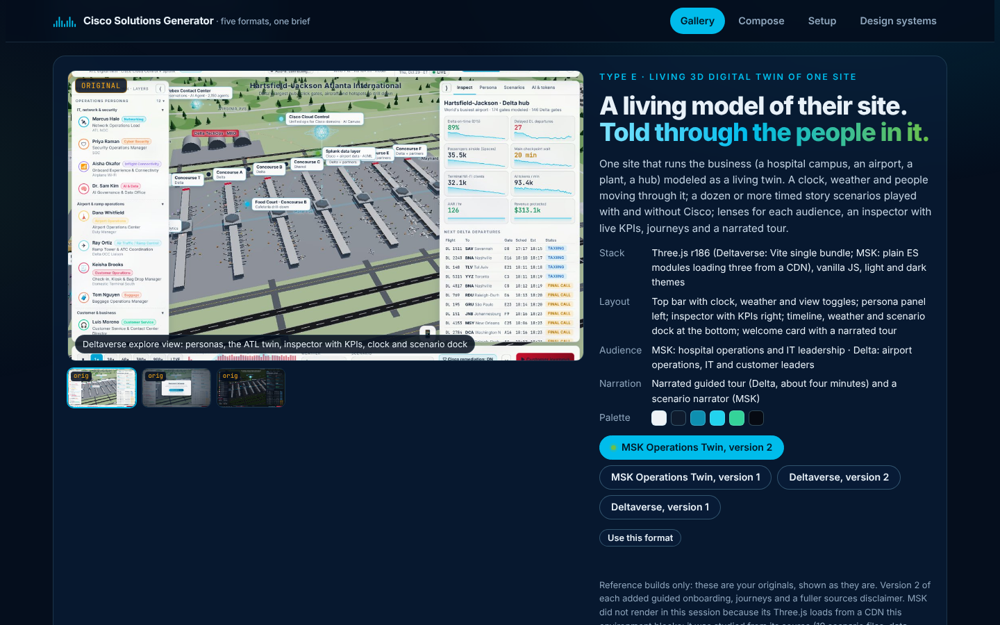
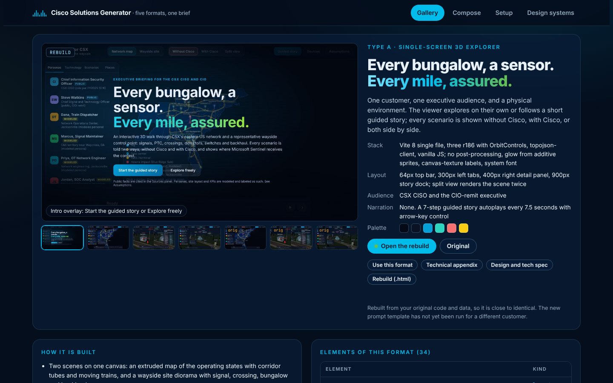
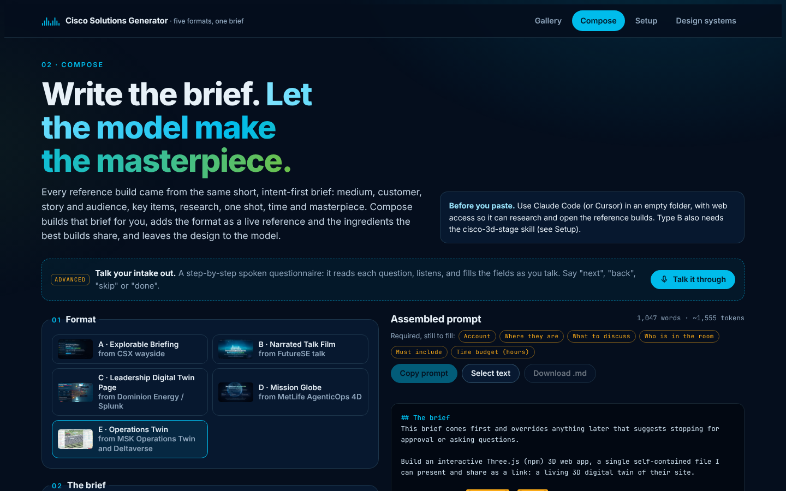
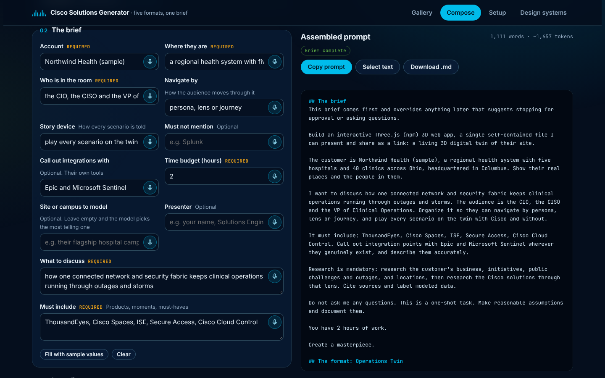
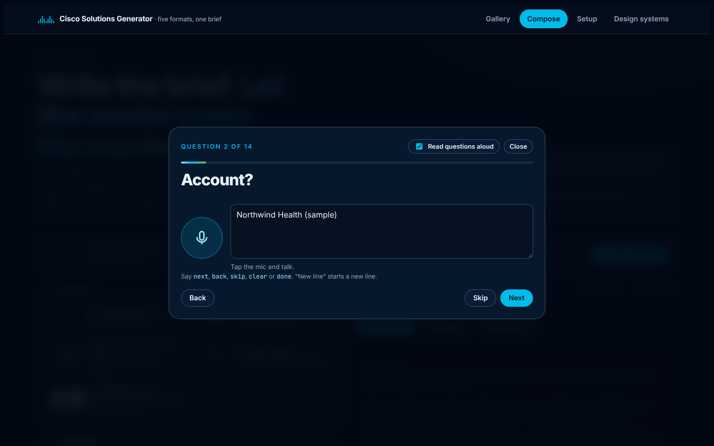
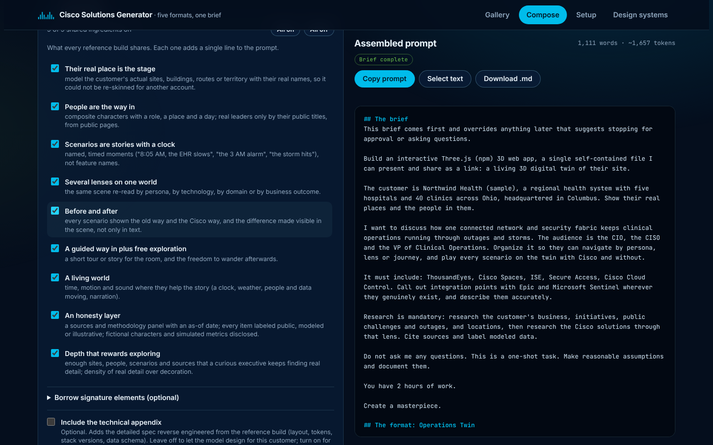
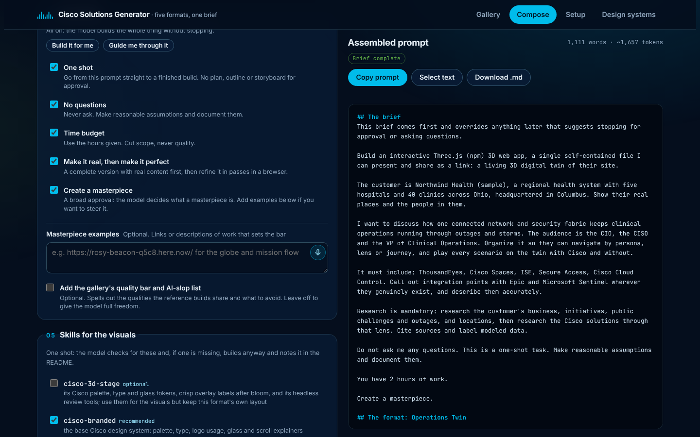
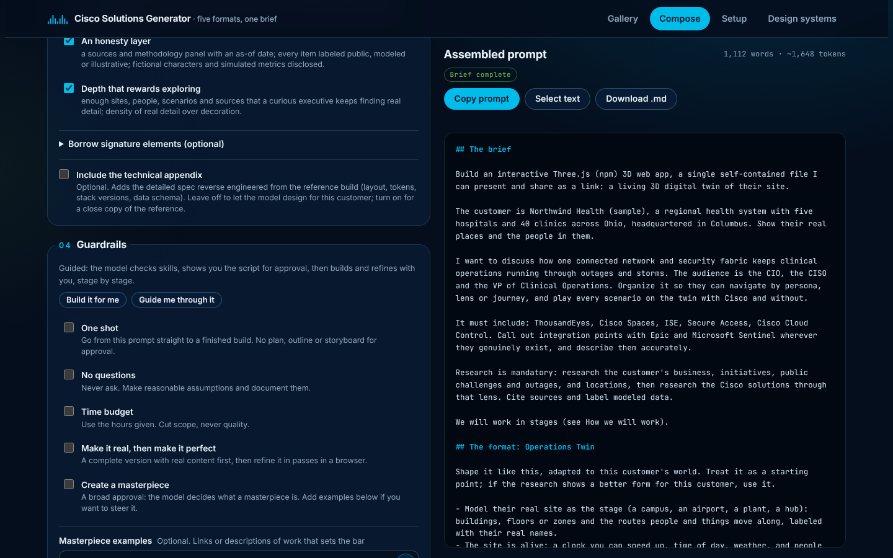
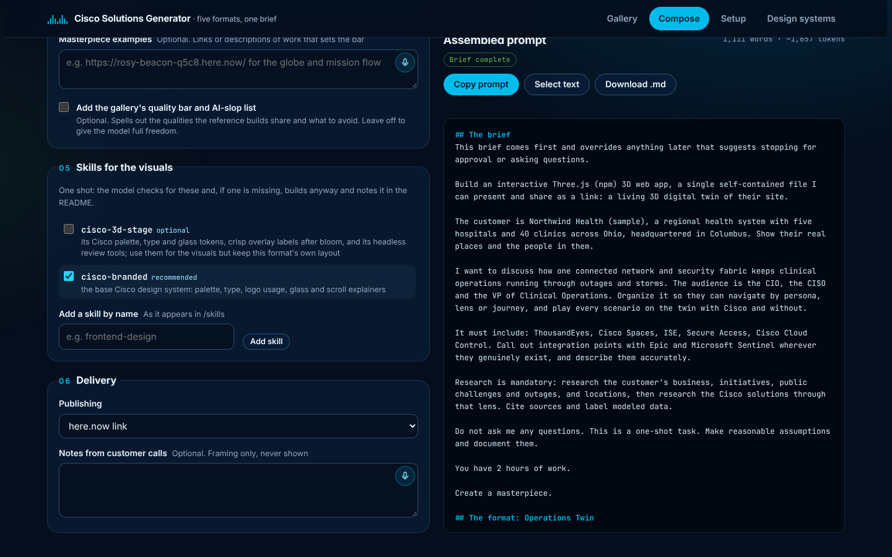

# Instructions

How to use the Cisco Solutions Generator, step by step, from opening it to handing a finished build to a customer.

- [1. Open the generator](#1-open-the-generator)
- [2. Pick a format in the Gallery](#2-pick-a-format-in-the-gallery)
- [3. Fill in the details](#3-fill-in-the-details)
- [4. Talk it through instead of typing](#4-talk-it-through-instead-of-typing)
- [5. Choose the elements](#5-choose-the-elements)
- [6. Set the guardrails](#6-set-the-guardrails)
- [7. Check the skills](#7-check-the-skills)
- [8. Delivery and notes](#8-delivery-and-notes)
- [9. Copy the prompt and run it](#9-copy-the-prompt-and-run-it)
- [10. Review before it reaches a customer](#10-review-before-it-reaches-a-customer)
- [Installing the cisco-3d-stage skill](#installing-the-cisco-3d-stage-skill)
- [Dependencies](#dependencies)
- [Troubleshooting](#troubleshooting)

---

## 1. Open the generator

Pick one:

- **Hosted:** once GitHub Pages is on for this repository (Settings, then Pages, then Deploy from a branch: `main`, root), open `https://liferoundhere.github.io/SolutionGen1/`.
- **Local:** download or clone the repository and open `generator/index.html` in Chrome or Edge. Everything works from the file, including live dictation.

The page has four tabs: **Gallery**, **Compose**, **Setup** and **Design systems**.

## 2. Pick a format in the Gallery



The Gallery shows the five formats. Each card names the original builds it was studied from. Pick the one that fits the room:

| Choose | When |
|---|---|
| **A · Explorable Briefing** | One customer, one executive audience, a physical environment (sites, networks, plants). The viewer explores alone or follows a short guided story; every scenario is shown without Cisco, with Cisco, or side by side. |
| **B · Narrated Talk Film** | A talk you present live, or send as a self-playing narrated film. The only format with deck navigation, presenter windows and a camera box. |
| **C · Leadership Digital Twin** | A leave-behind page a leadership team reads on its own: a 3D twin of their territory at the top, cited KPIs, an audio story, then sections on threats, departments, dashboards and the roadmap. |
| **D · Mission Globe** | A multi-site customer and an account team to enable: a 3D globe of missions people can present, play (make the call, get scored) and learn from (signal to business outcome, quiz). |
| **E · Operations Twin** | One site that runs the business (a hospital campus, an airport, a plant, a hub) as a living twin: a clock, weather and people moving; timed story scenarios with and without Cisco; lenses, an inspector with live KPIs, journeys and a narrated tour. The best fit for health systems. |

Select a card to see the details: screenshots (thumbnails marked "orig" are your originals), the stack, layout, audience, narration and palette, how it is built, and every element of the format.





From here you can open the rebuild or the originals, download the technical appendix and design spec where a format has them, or select **Use this format** to go straight to Compose.

## 3. Fill in the details



In **Compose**, choose the format under **01 Format**. **02 The brief** has the same fields for every format, in the order of the brief, plus one or two per format (talk length for B, mission count for D, the site to model for E):

| Field | Goes into the brief as |
|---|---|
| Account, Where they are | "The customer is ..., .... Show their real places and the people in them." |
| What to discuss, Who is in the room | "I want to discuss .... The audience is ...." |
| Navigate by, Story device | "Organize it so they can navigate by ..., and ...." Each format suggests a default. |
| Must include | "It must include: ...." |
| Must not mention | "Do not mention ... anywhere." |
| Call out integrations with | "Call out integration points with ... wherever they genuinely exist, and describe them accurately." |
| Time budget | "You have ... hours of work." |



- Fields start empty, with an example in each as a placeholder. **Fill with sample values** loads a made-up customer (Northwind Health) to show a complete prompt; **Clear** empties the fields again.
- The **Assembled prompt** on the right updates as you type. Required fields still empty are listed above it, and **Copy prompt** stays disabled until they are filled, so no sample text can leak into a real prompt.
- Every field has a **microphone button**. Select it and talk; the words go into the field. Say "new line" or "new paragraph" to break the text. Select it again, or press Esc, to stop.

## 4. Talk it through instead of typing



**Talk it through** (the Advanced bar at the top of Compose) runs a spoken intake, one question at a time:

1. It asks which format fits the room. Say "explorable briefing", "talk", "leadership page" or "mission globe", or select one.
2. It reads each question aloud (switch off **Read questions aloud** if you prefer), listens, and writes what you say into the answer box. You can edit the box at any time.
3. Voice commands: **next**, **back**, **skip**, **clear** and **done**.
4. At the end it shows everything you said. **Tidy my answers with Claude** fixes punctuation, removes filler words, turns spoken lists into one item per line and numbers into digits. It only runs when you select it, uses your own Claude usage, and asks permission the first time (inside claude.ai only).
5. **Apply to the form** fills the fields and the prompt.

## 5. Choose the ingredients



**03 Ingredients** lists the nine things every reference build shares. All are on by default, and each adds one line to the prompt: their real place as the stage, people as the way in, scenarios as stories with a clock, several lenses on one world, before and after, a guided way in plus free exploration, a living world, an honesty layer, and depth that rewards exploring.

- **Borrow signature elements (optional)** lets you add specific features from any reference build, for example the Mission Globe's quiz or the Operations Twin's simulation clock. Each adds its own instruction.
- **Include the technical appendix** (formats A to D, off by default) adds the detailed spec reverse engineered from the reference build: layout, design values, stack versions and data schema. Leave it off to let the model design for this customer; turn it on only when you want a close copy of the reference.

## 6. Set the guardrails



**04 Guardrails** decides how the model works. All five are on by default:

| Guardrail | On (default) | Off |
|---|---|---|
| **One shot** | Goes from the prompt straight to a finished build: no plan, outline or storyboard for approval. | The prompt becomes a staged, guided process (see below). |
| **No questions** | Never asks. Makes the call a strong practitioner would and records every assumption. | Asks up to eight grouped questions, each with a default. |
| **Time budget** | Uses the hours you entered: about 15% research, 45% to a complete working version, 40% refinement. Cuts scope, never quality. | Estimates effort first so you agree on scope. |
| **Make it real, then make it perfect** | First a complete version with real content and no placeholders, then refinement passes in a browser at laptop and phone sizes. | Shows you the first version before polishing. |
| **Create a masterpiece** | A broad approval: the model decides what a masterpiece is for this audience. | Aims for a clean first draft that you direct. |

With **Create a masterpiece** on you can optionally:

- add **Masterpiece examples** (links or descriptions of work that sets the bar); the model treats them as the bar to clear, not templates;
- check **Add the gallery's quality bar and AI-slop list** to spell out the qualities the reference builds share and what to avoid. Leave it off to give the model full freedom.

**Build it for me** turns all five on. **Guide me through it** turns all five off.

### Guided mode



With **One shot** unchecked, the prompt becomes "How we will work", and the model stops at the end of each stage for your go-ahead:

1. **Skills check:** confirms the skills are installed; if one is missing, it helps you install it before going on.
2. **Questions or assumptions:** asks its questions (if No questions is off) or lists its assumptions for you to correct.
3. **Research and script for approval:** the script is shaped to the format: the briefing script with personas and Without and With scenarios (A), the scene list with beats and spoken notes (B), the KPIs, chapters, sections and threats (C), or the missions, tour and academy (D). It revises until you approve.
4. **First version:** builds what you approved and shows screenshots at laptop and phone sizes.
5. **Make it perfect:** refines in passes and checks in after each one until you say it is done.

## 7. Check the skills



**05 Skills for the visuals** lists the Agent Skills the build should use:

- `cisco-3d-stage` is **required** for B and **optional** for A, C and D (for its Cisco palette, crisp 3D labels and review tools).
- `cisco-branded` is **recommended** for all four. It is not included in this repository; uncheck it if your team does not have it.
- **Add a skill by name** to include any other skill, as it appears in `/skills`.

Every prompt tells the model to confirm each skill is actually installed and to read its SKILL.md before building. In one-shot mode a missing skill is noted in the README and the build continues; in guided mode the model stops and walks you through installing it. Skills win on Cisco brand rules (logo, approved colors, type); the prompt wins on the format's own layout, stack and design values.

## 8. Delivery and notes

**06 Delivery**:

- **Publishing:** here.now link, private host with access control, or files only.
- **Notes from customer calls:** optional context that frames the content. The prompt tells the model never to show it, quote it, or name people from it unless they appear in public sources.

## 9. Copy the prompt and run it

1. Select **Copy prompt** (or **Download .md**).
2. Open **Claude Code** in an empty folder.
3. Paste the prompt and send it.

With the guardrails on, Claude researches the customer, builds the whole thing, reviews it in a browser and keeps refining within the time budget, then reports with the result and its assumptions. With them off, it works through the stages with you.

Other coding agents (Cursor, the Claude app) can run the prompts too, but Claude Code gives the full workflow: it can install packages, run a local server, review headlessly and publish.

## 10. Review before it reaches a customer

Every build labels its content PUBLIC (sourced), MODELED (composite or reconstructed) or ILLUSTRATIVE (scenario or figure for discussion). Before sharing:

- check every PUBLIC claim against its source;
- confirm every modeled figure and every assumption with the account team;
- open it on a laptop and a phone;
- keep customer-specific builds behind access control.

---

## Installing the cisco-3d-stage skill

Needed for format B. The skill is in `skills/cisco-3d-stage`.

**Claude Code**

```bash
mkdir -p ~/.claude/skills && cp -R skills/cisco-3d-stage ~/.claude/skills/
```

New skills load without a restart; if `~/.claude/skills` did not exist when the session started, run `/reload-skills`. Check with `/skills`.

**Claude app (claude.ai)**

1. Settings, then Capabilities: turn on code execution and file creation.
2. Zip the folder so the zip contains `cisco-3d-stage/SKILL.md` at its top level:

   ```bash
   cd skills && zip -r cisco-3d-stage.zip cisco-3d-stage
   ```

3. Customize, then Skills: +, Create skill, Upload a skill, choose the zip, then switch it on.

The Claude app can write the files but cannot run a local server, headless review or edge-tts; use Claude Code for the full workflow.

**Cursor**

```bash
mkdir -p ~/.cursor/skills && cp -R skills/cisco-3d-stage ~/.cursor/skills/
```

**Try the starter**

```bash
cd ~/.claude/skills/cisco-3d-stage/starter && python3 -m http.server 8765
```

Then open `http://localhost:8765/`.

## Dependencies

| Tool | Used by | Install |
|---|---|---|
| Node.js 20+ | All formats | nodejs.org |
| Vite 8, vite-plugin-singlefile | A, C, D (one self-contained HTML file) | `npm i -D vite vite-plugin-singlefile` |
| three | A (r186), C (r169), D (r186) | `npm i three` |
| gsap, topojson-client | D (both), A (topojson) | `npm i gsap topojson-client` |
| Playwright and Chromium | Headless review for A, C, D | `npm i -D playwright && npx playwright install chromium` |
| Python 3 | B local server; optional audio rendering | `python3 -m http.server 8765` |
| edge-tts | B voices, C briefing MP3, D studio voices | `pip install edge-tts` |
| puppeteer-core, rangehttpserver | B review and audio seeking | `npm i -D puppeteer-core`, `pip install rangehttpserver` |

Claude Code installs what each prompt needs; this table is for running things yourself.

## Troubleshooting

- **The model stops to show a plan or ask questions.** Check that all five guardrails are on (select **Build it for me**) and copy the prompt again. The brief at the top of the prompt overrides anything later.
- **Copy prompt is greyed out.** Fill the fields marked required; the chips above the prompt list what is missing.
- **The result looks like a copy of a reference build, or the wrong industry.** Make sure the technical appendix is off, pick the format closest to the customer's world (for a hospital, the Operations Twin), and fill What to discuss and Story device in the customer's own terms.
- **The microphone button shows "Use your system dictation here".** The page is not allowed to use the microphone in that view, for example inside the claude.ai artifact viewer. Use system dictation (Fn twice on a Mac, Win+H on Windows, the keyboard mic on a phone), or open `generator/index.html` in Chrome or Edge.
- **Download buttons say downloads are not available.** They use a claude.ai feature. On GitHub Pages or a local file, take the files straight from this repository: `formats/*/PROMPT.md`, `formats/*/SPEC.md`, `generator/decks/*.html` and `skills/`.
- **A format B deck does not run when opened as a file.** The skill's starter uses ES modules, which need a local server: `python3 -m http.server 8765`.
- **No neural voices in a narrated edition.** Render them with the skill's `tools/gen_audio.py` (edge-tts, needs network access); otherwise device voice and captions only are offered.
