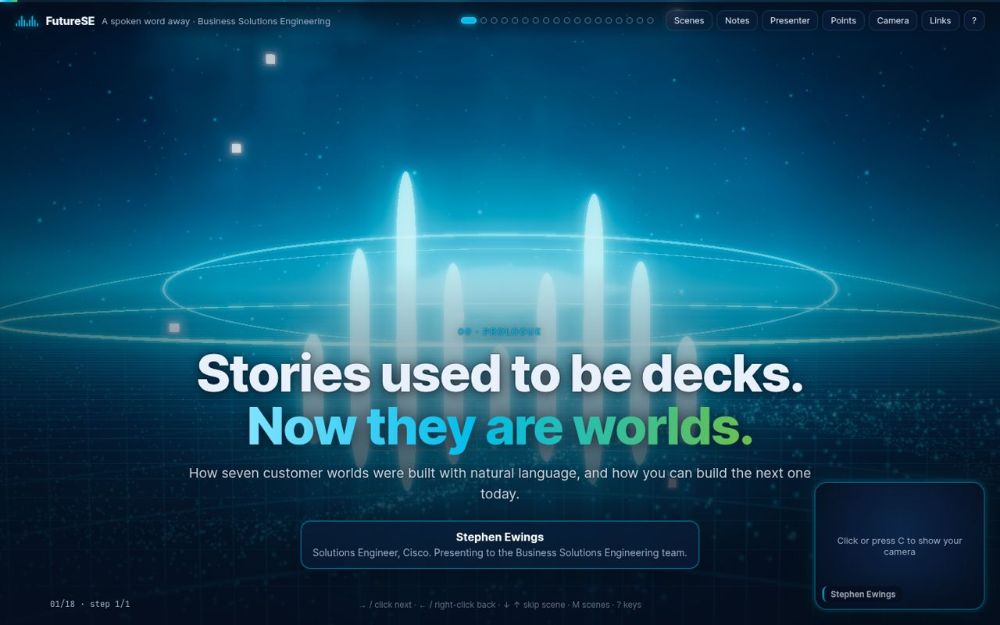
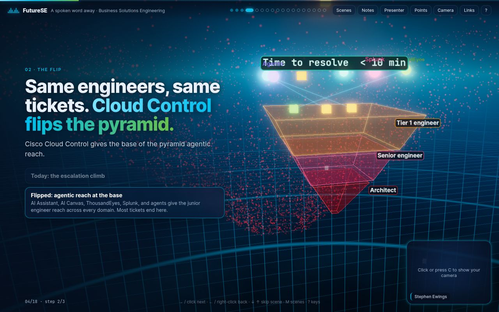
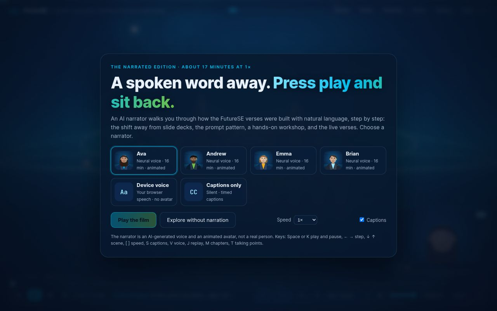
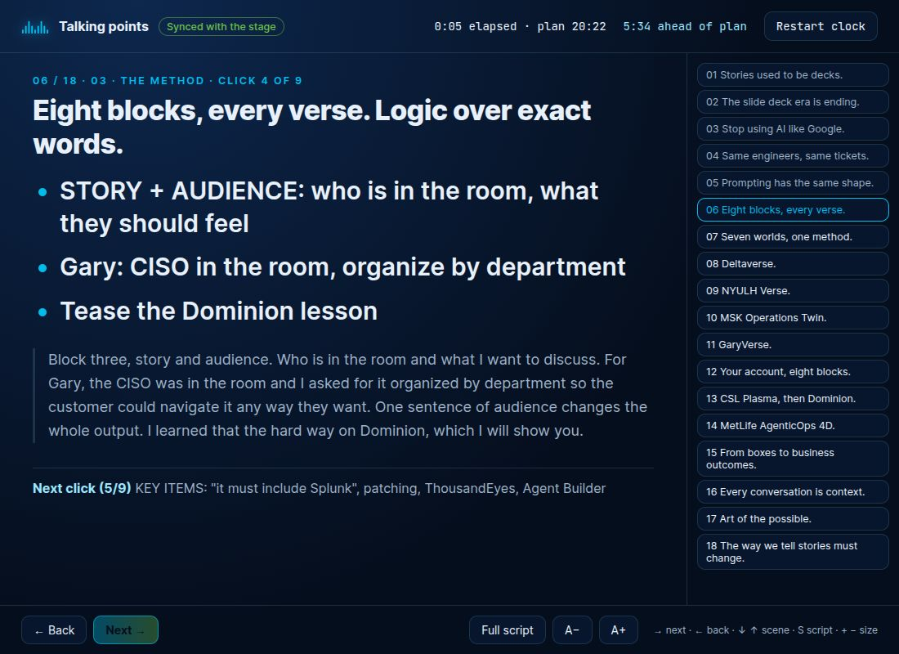
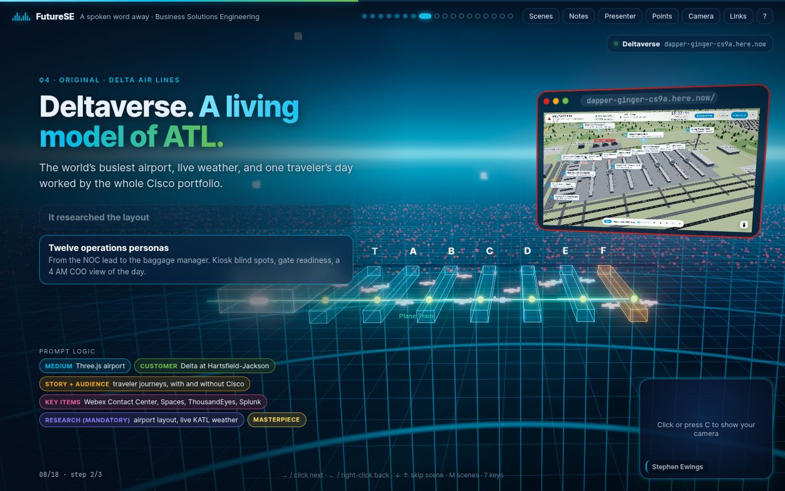
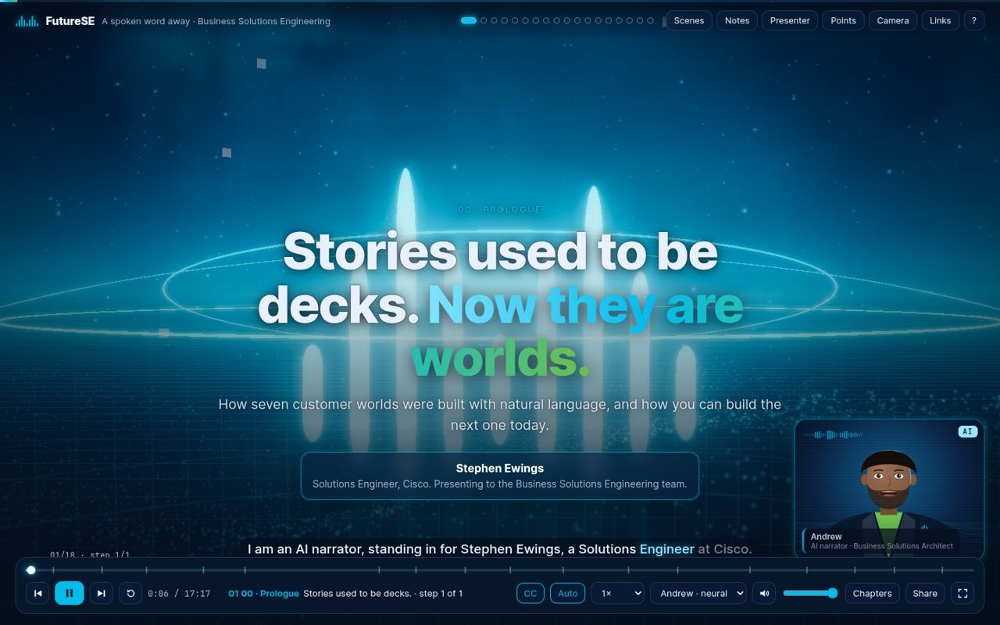
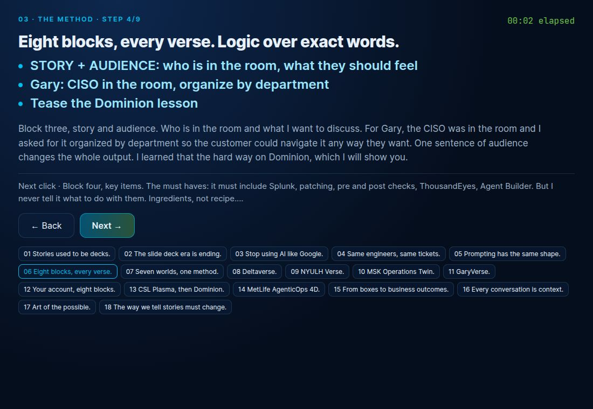
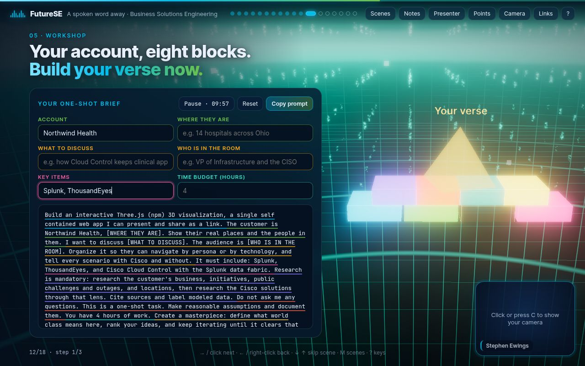
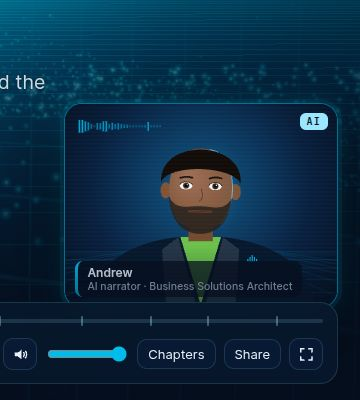
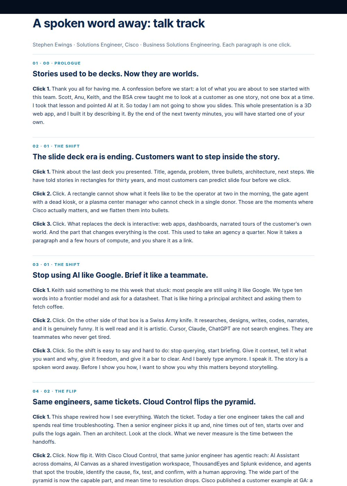

# SEVerse Skill: Cisco 3D Stage Presentations

**Turn any story into a Cisco-branded, interactive 3D presentation that you can present live or share as a self-playing film.**

This repository contains `cisco-3d-stage`, an agent skill (for Cursor, Claude, and other coding agents that load `SKILL.md` skills). It packages the design system and engine behind the FutureSE talk, *A spoken word away*, which Stephen Ewings (Solutions Engineer, Cisco) built for the Business Solutions Engineering team. With the skill installed, you describe a talk in plain language. The agent then builds a complete presentation web app with the FutureSE look, presenter tools and quality bar, and with content written for your audience.



---

## What it accomplishes

### 1. It replaces the slide deck with a world you move through

A normal deck is a stack of rectangles. This skill builds a **Three.js web app that still moves like a deck**: arrow keys and mouse clicks step through animations, and up and down skip whole scenes. The difference is that every scene is its own **lit 3D world**:

- **A new environment on every scene.** A sky shader blends aurora, horizon grid, data rain and starfield patterns, and its palette changes on every scene, and optionally on every click, so the room always knows something new is happening.
- **A shared particle field** of 7,000 points that reshapes itself to fit each scene: runways under an airport, a halo over a hospital, a city of departments, a map of a national network, the Cisco bridge bars at the close.
- **Camera flights** between scenes, with warp streaks and a gentle parallax.
- **A diorama for every idea.** Each scene shows its message as an object or a system: a pyramid that flips, a wall of slides that folds into a sphere, an airport with its concourses, a glass browser screen showing the real build.
- **Every click changes the world**, not just the text, and going back a step reverses it cleanly.
- **Crisp text in a glowing scene.** Labels, panels and screenshots render on their own layer after the bloom effect, so they stay sharp.

### 2. It gives the presenter real tools

- **Presenter camera box** in the bottom-right corner, using your webcam or hidden for a meeting app camera.
- **Presenter window** (P) and a dedicated **off-camera talking-points window** (T). Both sync with the stage in both directions:
  - large bullets for the current click and a preview of the next one;
  - the full script on demand;
  - a pace clock that says whether you are on plan, ahead or behind.
- **Notes drawer**, **scene menu**, a **printable talk track**, **deep links** to any scene and step, a clean mode that hides the HUD, and live buttons that open the real builds.
- **A live workshop in the middle of the talk.** The audience fills in a short brief and the 3D foundation lights up as they type. A 10-minute timer appears, and the finished prompt is copied with one click.

### 3. It turns the same deck into a narrated film anyone can play

One command builds a **second edition** of the same deck that plays by itself:

- **Four premium neural voices** (Ava, Andrew, Emma and Brian) are rendered ahead of time, so the published site needs no API keys and works offline. There is also a device-voice fallback and a silent, captions-only mode.
- **An animated AI narrator.** A stylized Business Solutions Architect appears in the presenter box, clearly badged "AI". It blinks, breathes, nods, and lip syncs from the live audio level and the word being spoken.
- **Full playback controls:**
  - play and pause, step back and forward, and replay the current step;
  - a timeline with scene markers and seeking;
  - speed from 0.75x to 2x, a voice switcher, volume and mute;
  - captions that highlight each word as it is spoken;
  - auto-advance on or off, a chapter menu and fullscreen;
  - media keys, and a **share link to the exact moment** with the chosen voice and speed.
- **It knows when to stop.** The film pauses at the workshop and waits for "Continue", then ends with a replay and share card.

### 4. It keeps every output on brand and at a high bar

- The Cisco midnight, blue and green palette, Inter type, glass panels, and two-clause headlines with a gradient outcome clause.
- Copy rules: no em dashes, numbered eyebrows, and notes written to be spoken.
- A built-in **quality checklist** and **headless review tools** that screenshot every scene at desktop and mobile widths and test navigation, window sync and the film flow.
- **Security by default:**
  - no secrets in source;
  - live links accept `https://` only;
  - audio is pre-rendered, so nothing calls an API at runtime;
  - the AI narrator always discloses that it is AI and never impersonates the presenter.

### 5. It explains itself

Generated decks come with `TALKING_POINTS.md`, `SCRIPT.md` (with the runtime of each voice) and `TALK_TRACK.md`, so the presenter can rehearse and the audience can follow up.

---

## Why it matters

Customers do not live in rectangles. This skill lets an SE or BSA walk a customer through their own world in a format that is built in hours, shared as a link, and memorable for the room. It does that without design or 3D expertise, and it keeps every result consistent and on brand. It also makes the method teachable. The deck it came from shows how one structured, one-shot brief replaces dozens of follow-up questions, and how anyone on the team can build the next one.

---

## How to use it

### Install the skill

Copy the `cisco-3d-stage/` folder into your agent's skills directory, for example `~/.cursor/skills/cisco-3d-stage/` for Cursor, or the equivalent for your agent. The agent picks it up from `SKILL.md`.

### Ask for something

> "Build me a Cisco-branded 3D presentation for the Northwind Health QBR: 12 scenes, 15 minutes, with a workshop in the middle. Also make a narrated version I can send to people who miss the meeting."

The agent then:
1. writes the scene list, copy, talk track and talking points;
2. designs a 3D world for each scene;
3. builds it from the starter and renders the narration;
4. reviews it headlessly and fixes what it finds;
5. hands you both links and the documents.

### Run the starter yourself

```bash
cd cisco-3d-stage/starter
python3 -m http.server 8765          # open http://localhost:8765/
```

Narrated edition:

```bash
pip install edge-tts rangehttpserver
node tools/export_narration.mjs tmp/narr.json
bash tools/sync_narrated.sh ../narrated
python3 tools/gen_audio.py tmp/narr.json ../narrated/audio
cd ../narrated && python3 -m RangeHTTPServer 8766   # range support lets the scrubber seek
```

Everything runs offline from any static server. Three.js r170, Inter and JetBrains Mono are vendored. Nothing needs a build step.

---

## What is in this repo

```
cisco-3d-stage/
  SKILL.md                     Workflow, quality bar, copy and security rules
  references/
    stage-engine.md            Architecture, render pipeline, scene contract, sky, particles
    scene-recipes.md           Proven scene patterns and step choreography
    design-and-layouts.md      Palette, type, HUD layouts, components, motion, mobile
    presenting.md              Keys, presenter and talking-points windows, workshop, deep links
    narrated-edition.md        Voices, audio pipeline, film player, captions, AI narrator
    review-and-publish.md      Headless review, behavior tests, publishing, deliverables
  examples/                    21 screenshots of the original FutureSE build
  starter/                     A runnable 7 scene sample deck covering every layout and both editions
    index.html, talking-points.html, css/, js/, media/, vendor/
    tools/                     gen_audio.py, export_narration.mjs, sync_narrated.sh, gen_docs.mjs, review.mjs
```

The starter's copy is placeholder by design. The skill is a look and an engine, not a talk: every new deck's content comes from its own request.

## Gallery

| Stage | Narrated film | Presenter tools |
| --- | --- | --- |
|  |  |  |
|  |  |  |
|  |  |  |

## Related

- `cisco-branded`: the base Cisco design system skill (palette, type, glass and scroll explainers) that this skill extends.
- SEVerse, *From Boxes to Business Outcomes*: the explainer where the method was first packaged as a skill.

## Credits and licenses

Created by Stephen Ewings, Solutions Engineer, Cisco, with Cursor. The third-party components are listed in `THIRD_PARTY_NOTICES.md`. Cisco names and marks belong to Cisco Systems, Inc. Customer names in the example screenshots refer to past internal presentations; replace them in any new work.
